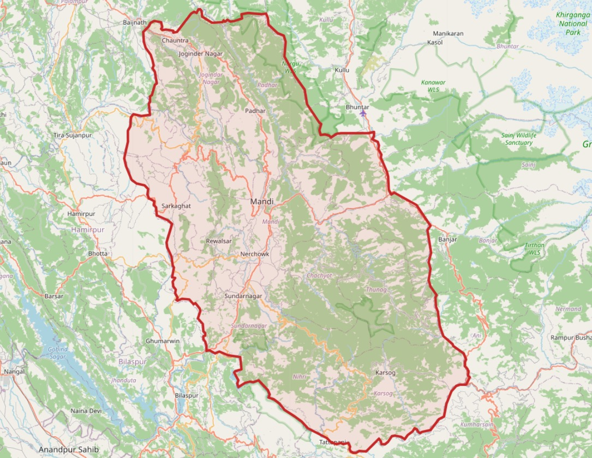

# Mandi Education Market Analysis

  GIS-Based Educational Market Research & Location Intelligence
  
  Mandi District, Himachal Pradesh, India

  
  
  
  

---

## About the Project

**Mandi Education Market Analysis** is a GIS-based research project focused on exploring potential locations for establishing a new technical training institute branch in Mandi District, Himachal Pradesh, India.

The project uses geographical data, educational institution information, and spatial analysis techniques to understand the distribution of colleges and identify areas with potential student demand.

The primary objective is to support data-driven location planning for a new branch of **Excellence Technology**.

## Project Objectives

- Map colleges and educational institutions across Mandi District.
- Analyze the geographical distribution of target colleges.
- Visualize educational institution locations using interactive maps.
- Highlight the Mandi District administrative boundary.
- Perform geographic buffer analysis.
- Identify areas with a higher concentration of colleges.
- Explore potential student catchment areas.
- Support future branch location planning through spatial analysis.

## Study Area

**Mandi District, Himachal Pradesh, India**

The initial research focuses on institutions offering or potentially relevant to the following programs:

- BCA – Bachelor of Computer Applications
- MCA – Master of Computer Applications
- BTech – Bachelor of Technology
- MTech – Master of Technology

## Project Screenshots

### 1. Interactive College Map

Geographical distribution of identified colleges across Mandi District.

### 2. Mandi District Boundary

Administrative boundary visualization of Mandi District.

### 3. Buffer Zone Analysis

Geographic buffer zones to understand spatial coverage around colleges and potential branch locations.

### 4. College Density Heatmap

Visualization of areas with a higher geographical concentration of identified colleges.

## Technology Stack

| Technology | Purpose |
|---|---|
| Python | Main programming language |
| Pandas | Data processing and cleaning |
| Folium | Interactive maps |
| GeoPandas | Geospatial data processing |
| Shapely | Geographic geometry and buffers |
| PyProj | Coordinate reference systems |
| OpenStreetMap | Base map visualization |
| Excel | Initial dataset |

## Analysis Methodology

### 1. Data Collection

Collect educational institution information such as:

- College name
- Address
- Latitude and longitude
- Available courses
- District information

### 2. Data Cleaning and Verification

- Validate geographical coordinates.
- Standardize institution names.
- Identify duplicate records.
- Review course information.
- Verify college locations using reliable sources.

### 3. Geographic Visualization

Use Folium to visualize:

- College locations
- Marker clustering
- Course-based map layers
- College density heatmaps
- District boundaries

### 4. Buffer Analysis

Study geographical coverage using different buffer distances:

- 2 km
- 5 km
- 10 km

These buffers represent straight-line distances, not actual road travel distances.

### 5. Spatial Analysis

Explore:

- College density
- Educational institution clusters
- Geographic distribution patterns
- Potential branch locations
- Student catchment areas

### 6. Location Suitability Assessment

Compare potential locations using available indicators:

- Nearby target colleges
- College concentration
- Course diversity
- Geographic accessibility
- Estimated student potential

Actual student demand, rental costs, and business feasibility will require additional research.

## Project Roadmap

- [x] Define project objectives and study area.
- [x] Prepare initial college dataset.
- [x] Develop an interactive Folium college map.
- [x] Visualize college density and geographic buffers.
- [ ] Verify college names and course information.
- [x] Improve coordinate accuracy.
- [x] Validate the administrative district boundary.
- [x] Perform college clustering analysis.
- [x] Identify potential branch location candidates.
- [x] Compare candidate locations.
- [x] Prepare the final research report.

## Data Limitations

- Initial college records require manual verification.
- Course tags do not independently confirm current course availability.
- Student population data is not directly available in the initial dataset.
- Geographic buffers do not represent actual road travel distances.
- College density alone cannot determine the best branch location.
- Final decisions require verified data, student demand research, accessibility analysis, and rental feasibility.

All findings should be treated as preliminary until the underlying information is verified.

## Future Scope

- Road network and travel-time analysis.
- Student enrolment data integration.
- Advanced spatial clustering.
- Candidate location ranking.
- Interactive GIS dashboards.
- Educational market potential analysis.
- Business feasibility assessment.

## Project Purpose

This project demonstrates how **GIS, Python, and Data Analytics** can be applied to a real-world business expansion problem.

The goal is to transform geographical and educational data into meaningful insights that support location-based business planning.

---

## Author

**Pratik Suman**

GIS Intern

## Organization

**Excellence Technology**

---

  **Turning Geographical Data into Business Insights.**

